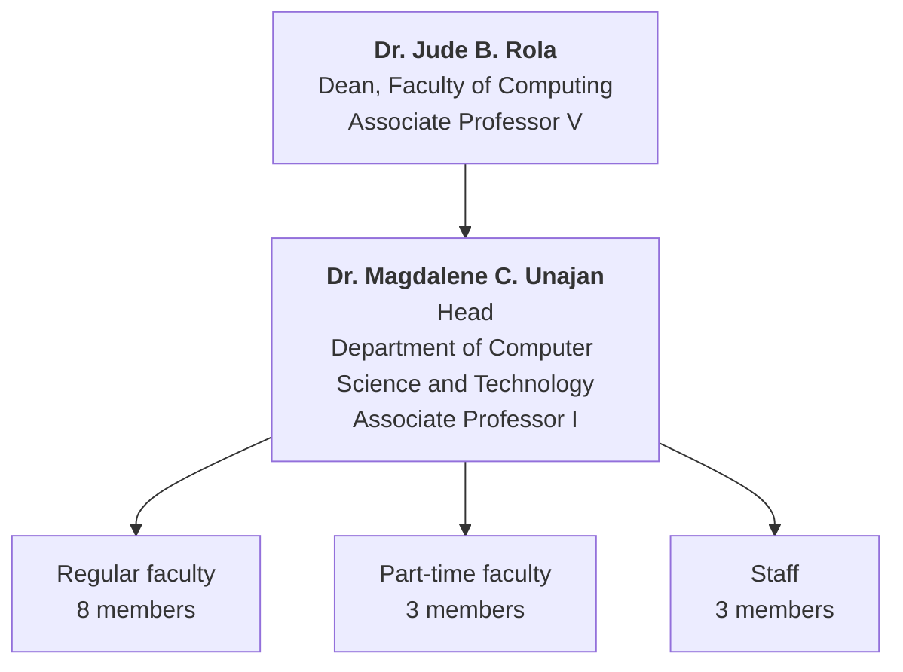

  
  <h3>Department of Computer Science and Technology</h3>
  
<strong>Faculty of Computing · Visayas State University</strong> 
  Visca, Baybay City, Leyte, Philippines

---

This is the official GitHub organization of the **Department of Computer Science and Technology (DCST)** at Visayas State University. It holds the department's public code and teaching materials; internal working documents are kept in private repositories visible only to members.

## About the department

The department is part of the **Faculty of Computing**. It teaches computer science to undergraduate students of the university and carries out instruction, research, development, and extension work in computing, with particular attention to agriculture, science, and allied fields. Faculty and students work together on software, instructional materials, and research projects, and many of those are maintained here.

## Programs

| Program | Status | Notes |
| ------- | ------ | ----- |
| **Bachelor of Science in Computer Science (BSCS)** | Offered | First offered in 2002, with pioneer graduates in 2006. AACCUP-accredited; the Level IV Phase 2 revisit was conducted in September 2026. |

The BSCS curriculum is outcomes-based and follows the CHED policies for the program. Course materials, syllabi, and teaching guides produced by the department are published in this organization where they are meant for public use.

## Vision, Mission, Goals, and Objectives

Adopted by the department on **22 January 2025**.

### Vision

> A globally recognized department in industry-aligned and sustainable computing education, research, community engagement, and innovation.

### Mission

> To produce graduates equipped with knowledge and skills in computing sciences, innovative research and development; cultivate inclusivity and socially responsible computing professionals who advance technology, foster collaboration, and address real-world challenges.

### Goals

1. Graduates of the program are IT professionals and researchers, and proficient in designing and developing computing solutions.
2. Generate appropriate knowledge in Information and Communications Technology relevant to agricultural production, processing, utilization, technology generation and disseminations; and
3. Sustainable linkages and cooperation with public and private institutions in instruction, research and developments and extension.
4. Dynamic linkages with other agencies and institutions for the promotion of instruction, research, extension programs in computer science and allied fields.
5. Sustained linkages among the various units within the university to support developmental programs.

### Objectives

1. To provide relevant undergraduate and graduate curricular programs in computer science and allied fields.
2. To develop a strong and dynamic faculty and staff in computer science and allied fields.
3. To produce highly employable graduates in computer science and allied fields.
4. To achieve long-term linkages and cooperation with local, national, international institutions and agencies involved in the development and utilization of information and communication technology.
5. To provide technical assistance in the utilization of information and communication technology.
6. To cooperate with other units within the university to support developmental programs.

## Organization

### Regular faculty

| Faculty member | Rank |
| -------------- | ---- |
| Dr. Jonah Flor O. Maaghop | Associate Professor III |
| Mr. Michael Anthony Jay B. Regis | Associate Professor II |
| Mrs. Maricel V. Calhoun | Assistant Professor II |
| Mr. Jomari Joseph A. Barrera | Assistant Professor I |
| Mr. Eugene Val D. Mangaoang | Instructor III |
| Mr. Nelson H. Tejara | Instructor III |
| Mr. Rodney M. Maniego, Jr. | Instructor I |
| Mrs. Abegail P. Calixtro | Instructor I |

### Part-time faculty

| Faculty member |
| -------------- |
| Ms. Yvonn Kyla V. Magallon |
| Mr. Kyle Anthony F. Nierras |
| Mr. Graeme Xyber N. Pastoril |

### Staff

| Staff member | Designation |
| ------------ | ----------- |
| Mr. Joseph C. Martinez | Deputy Documents and Records Controller |
| Mr. Michael D. Dag-uman | Administrative Aide III / Department Clerk |
| Mr. Dionesio I. Estupa | Laboratory Technician |

## Contact

| | |
| --- | --- |
| **Email** | [dcst@vsu.edu.ph](mailto:dcst@vsu.edu.ph) |
| **Telephone** | +63 53 565 0600 local 1022 |
| **Address** | Department of Computer Science and Technology, Visayas State University, Visca, Baybay City, Leyte, Philippines |

For student and faculty inquiries about a repository here, open an issue on that repository or write to the department address above.
